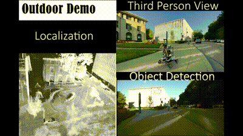
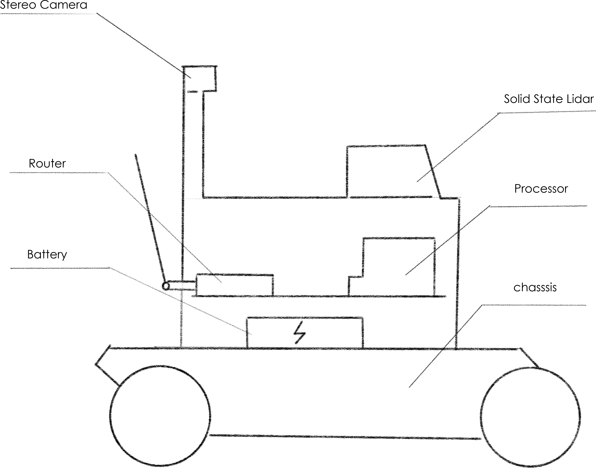
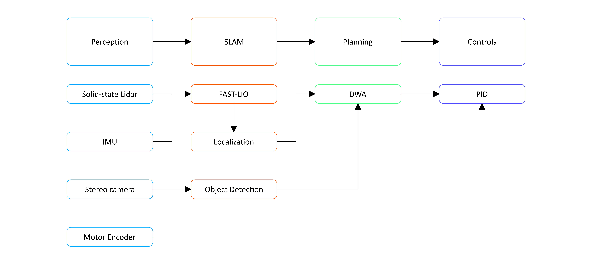
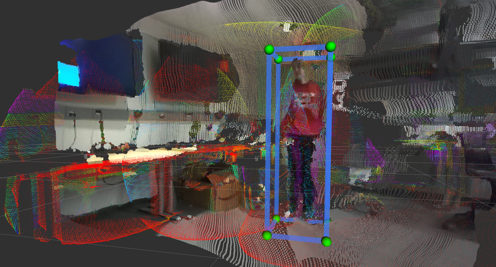
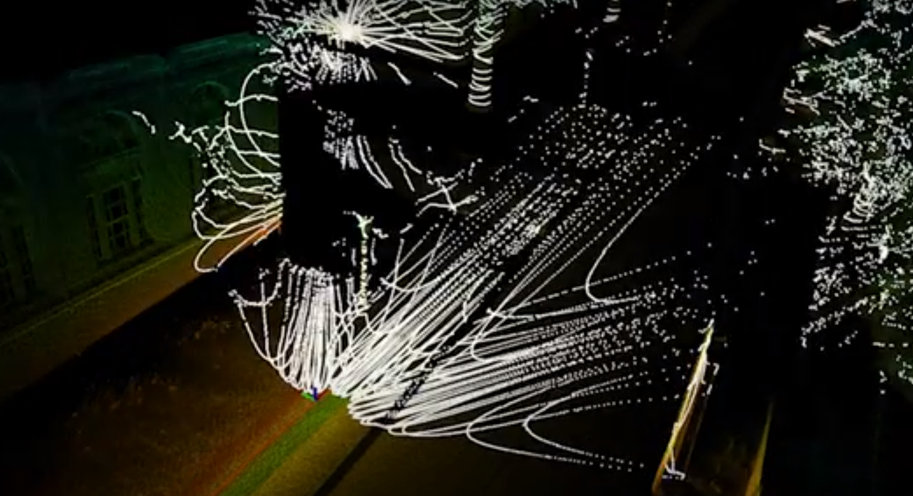
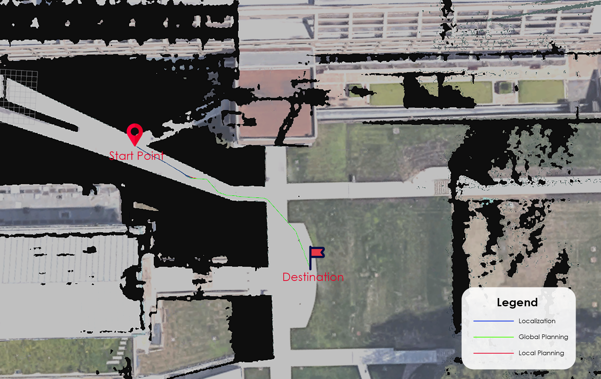
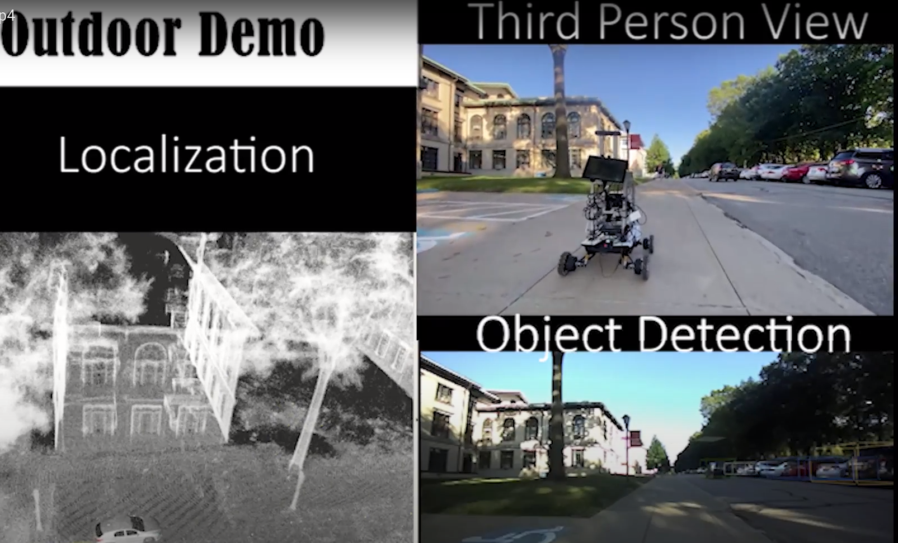

# SafeAI Delivery Robot

**Stereo camera and solid-state LiDAR object detection on a small delivery robot**
Jiarun Wei, Ding Zhao · Safe AI Lab, Carnegie Mellon University · 2021–2022



A prototype autonomous delivery robot — about half a person tall, on mecanum wheels, carrying a small parcel — that navigates between arbitrary start and goal points inside a prebuilt map of the CMU campus. The project explores a low-cost sensing setup for small, slow robots: a **stereo camera** for object detection, stabilized by cheap **solid-state LiDARs** instead of a spinning Velodyne.

📄 Full report: [docs/report.pdf](docs/report.pdf)

## System



| Part | Qty | Role |
| --- | --- | --- |
| Livox Mid-70 solid-state LiDAR | 3 | Mapping, localization, verifying detections |
| SLAMTec LiDAR | 2 | |
| ZED / ZED 2 stereo camera | 2 | Object detection (people, vehicles) |
| NVIDIA Jetson AGX Xavier | 2 | Onboard compute, CUDA inference |
| Router | 2 | Ethernet link between LiDARs and Xavier, sync |
| Power banks (Krisdonia, MAXOAK) | 3 | Power for Xavier (20 V), LiDARs and router (12 V) |
| Mecanum chassis + joystick controllers | 1 + 2 | Drive base, connected to Xavier over USB/CAN |

## Pipeline



**Perception — Stereo R-CNN 3D object detection.** The camera stream runs [Stereo R-CNN](https://arxiv.org/abs/1902.09738):

1. **Feature extraction** with a ResNet backbone on the left and right images.
2. **Region proposal** with a Faster R-CNN style RPN (anchor generation, foreground/background classification, box regression).
3. **RoI alignment** and classification of candidate boxes against ground truth by overlap.
4. **Keypoint prediction and 3D box estimation** using the binocular geometric constraints.

LiDAR point clouds are projected onto the detections to check them — stereo depth is only reliable within a certain range, and the LiDAR gives precise depth where the camera is unstable.



**Localization and mapping.** The LiDARs scan the area to build a 3D point-cloud map, which is projected to a 2D map for navigation. At runtime the robot localizes by **NDT (Normal Distributions Transform)** matching of the current scan against the map, fused with the **IMU** through a **Kalman filter**: the IMU is immune to surrounding obstacles but drifts, while scan matching self-corrects but is sensitive to the environment.



**Planning and control.** Global path with **A\***, local path with the **Dynamic Window Approach (DWA)** over the robot state $(\dot x, \dot y, \dot\theta)$, and wheel speed held by **PID** on motor encoder feedback.


*Green: global path · red: local path · blue: localization.*

**Camera calibration.** Intrinsics $f_x, f_y, c_x, c_y$ and radial/tangential distortion $k_1, k_2, p_1, p_2, k_3$ for both lenses, calibrated with OpenCV (values in the report).

## Results

- Stereo detections of people line up closely with the LiDAR points, indoors and outdoors.
- Outdoors on the CMU campus the robot reliably navigates from its start to any goal inside the prebuilt map (e.g. Hunt Library ↔ the gym).
- Lessons from the field: only one of the three LiDARs synced during the outdoor demo, and fast mecanum rotation plus the LiDAR update rate made turns hard for perception — the IMU + Kalman fusion kept overall performance acceptable. Thicker Ethernet cables raised LiDAR bandwidth, and a tuned fan profile kept the Xavier from throttling.



## Bring-up notes

**Power** — LiDARs and router take 12 V; connect at most one LiDAR per power bank or the sampling rate becomes unstable. The Xavier takes 20 V on its own power bank.

**Data** — each LiDAR → router over Ethernet → Xavier; ZED camera → Xavier over USB; chassis → Xavier over USB (CAN).

**Remote controller** — flip levers 1–4 up, hold buttons 5 and 6, flip lever 1 down and lever 2 to the middle, then power the chassis and wait ~5 s for it to pair.

<details>
<summary>Capture a calibration image from the ZED camera</summary>

```python
import pyzed.sl as sl
import cv2

init_params = sl.InitParameters()
init_params.camera_resolution = sl.RESOLUTION.HD2K
zed = sl.Camera()
zed.open(init_params)
if not zed.is_opened():
    exit()

zed.grab()
image = sl.Mat()
zed.retrieve_image(image)          # left image
cv2.imwrite("test.png", image.get_data())
```
</details>

<details>
<summary>Reflash the Jetson AGX Xavier</summary>

1. Recovery mode: unplug power, hold the recovery (middle) button, plug power in, press power, release.
2. On an Ubuntu 18.04 host, install NVIDIA SDK Manager and sign in with a developer account.
3. Connect the Xavier over USB. In step 1 select only the target machine; start step 2 and wait for the download.
4. When asked to flash, choose **NVMe** as the target. After Jetson OS is flashed, wait ~5 min and click Connect.
</details>

## Future work

Active perception (pan/tilt sensors with variable extrinsics), a stiffer sheet-metal frame, a 3D voxel cost map so slopes are not treated as obstacles, and camera-only depth (monocular depth estimation) as a LiDAR substitute.

## Acknowledgments

Thanks to Prof. Ding Zhao and the Safe AI Scout team at the Safe AI Lab.
